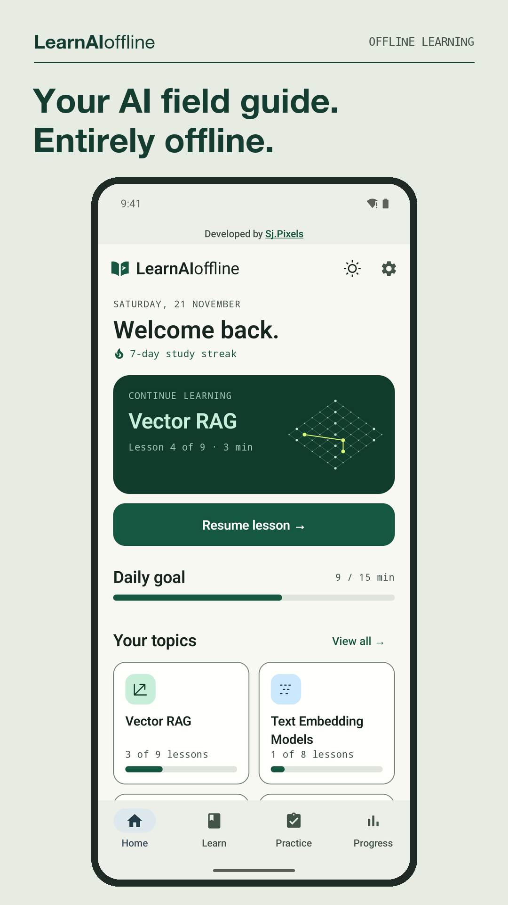
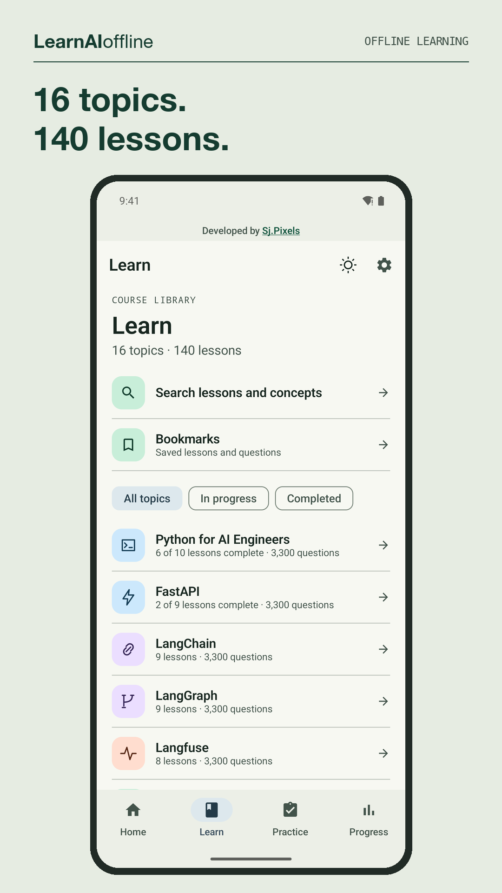
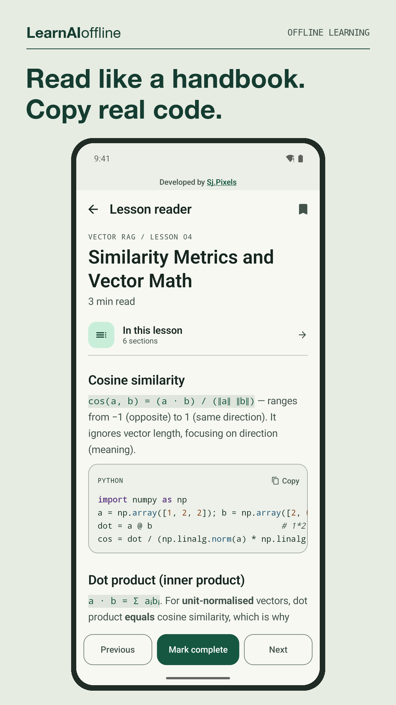
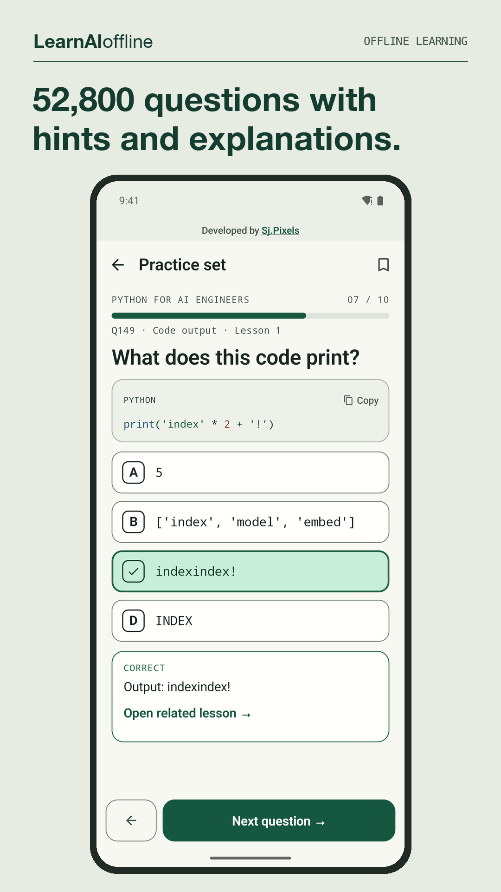
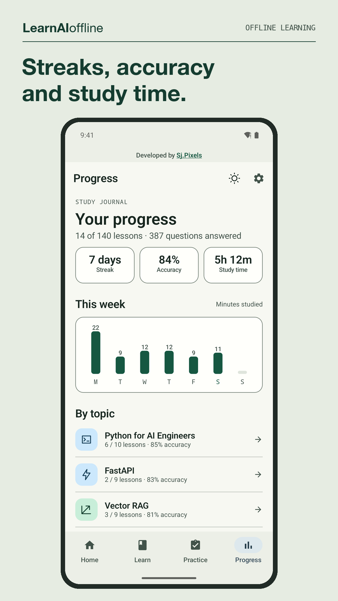
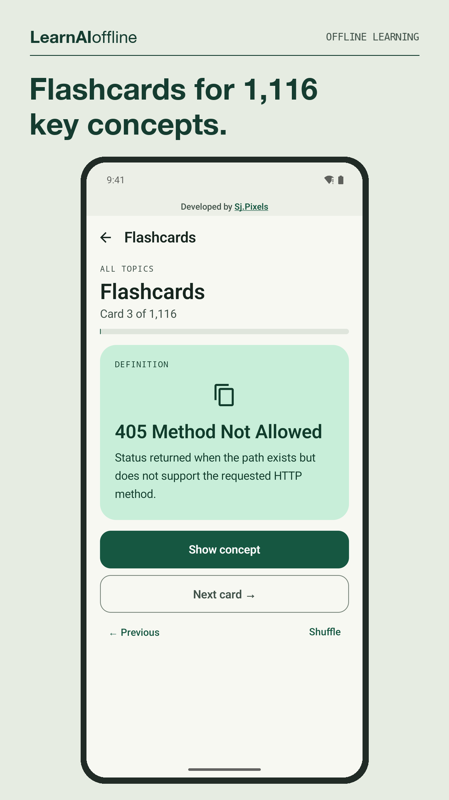
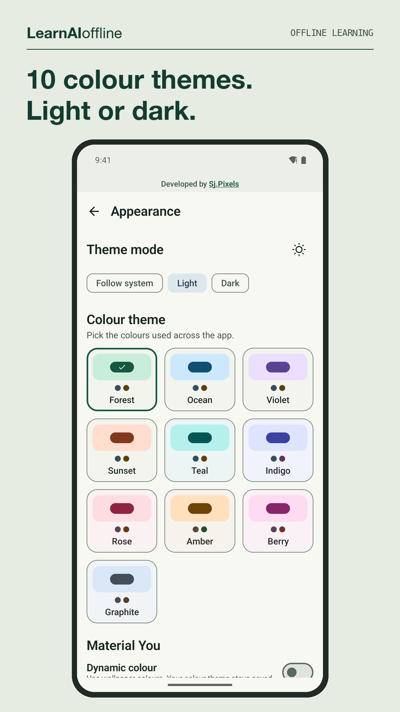
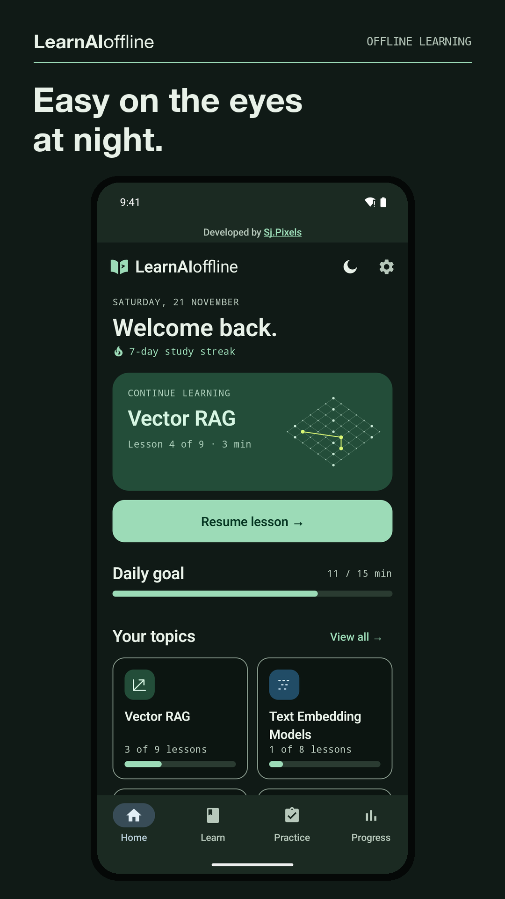

<div align="center">


# LearnAIoffline

**Your AI field guide. Entirely offline.**

Learn the modern AI-engineering stack on your Android phone: 16 topics, 140 lessons,<br/>
1,116 key concepts and 52,800 practice questions. No account, no ads, no internet needed.

<a href="https://play.google.com/store/apps/details?id=com.sjpixels.learnaioffline">
  
</a>


-165741)


</div>

---

## 📱 Screenshots

<p align="center">
  
  
  
  
</p>
<p align="center">
  
  
  
  
</p>

## ✨ Highlights

| | |
|---|---|
| 📚 **Learn** | 140 handbook-style lessons with a section index, field notes, tables and syntax-highlighted code you can copy |
| 🎯 **Practice** | 52,800 multiple-choice questions (3,300 per topic), each with a hint, sample code, an explanation and a link to its lesson |
| 🧩 **Seven practice modes** | Continue in order, random set, by lesson, review mistakes, unanswered, bookmarked, start from a number, plus a filterable question bank |
| 🗂️ **Key concepts** | A glossary of 1,116 concepts with search, plus flashcards |
| 📈 **Progress** | Daily goal, streaks, accuracy, study time, a this-week chart, per-topic and per-lesson progress, daily history |
| 🎨 **Themes** | Light, dark or system; an animated day/night switch; 10 colour themes (all WCAG AA); wallpaper colours on Android 12+; AMOLED black |
| 📖 **Comfortable reading** | Adjustable text size, line spacing, code size and code theme |
| 🔒 **Private by design** | Fully offline, no accounts, no ads, no analytics, no permissions. Progress lives in local SQLite, with export / import in Settings |

## 🧠 What you'll learn

| # | Topic | Lessons | Questions |
|:-:|---|:-:|:-:|
| 1 | 🐍 Python for AI Engineers | 10 | 3,300 |
| 2 | ⚡ FastAPI | 9 | 3,300 |
| 3 | 🦜 LangChain | 9 | 3,300 |
| 4 | 🕸️ LangGraph | 9 | 3,300 |
| 5 | 🪢 Langfuse | 8 | 3,300 |
| 6 | 🦙 LlamaIndex | 9 | 3,300 |
| 7 | 🧭 Vector RAG | 9 | 3,300 |
| 8 | 🔗 Graph RAG | 7 | 3,300 |
| 9 | 🧬 Hybrid RAG | 7 | 3,300 |
| 10 | 🏗️ RAG Architectures (with examples) | 10 | 3,300 |
| 11 | 🤖 Agentic AI & Frameworks (CrewAI, LangGraph, OpenAI Agents SDK, Google ADK, Microsoft Agent Framework, smolagents…) | 10 | 3,300 |
| 12 | 📐 Text Embedding Models | 8 | 3,300 |
| 13 | 🧠 LLM Models | 9 | 3,300 |
| 14 | 📊 RAGAS | 8 | 3,300 |
| 15 | 🧰 AI Frameworks Landscape | 9 | 3,300 |
| 16 | 🔌 Model Context Protocol (MCP) | 9 | 3,300 |
| | **Total** | **140** | **52,800** |

## 🛠️ Tech stack

| Area | Choice |
|---|---|
| Language | Kotlin 2.2.20 |
| UI | Jetpack Compose (BOM 2025.10.01), Material 3, AndroidX Core SplashScreen |
| Build | Android Gradle Plugin 8.13.2, Gradle 8.14.3, JDK 17, R8 shrinking for release |
| Storage | SQLite (progress, bookmarks, history) and SharedPreferences (settings) |
| Content | JSON assets generated by a Python pipeline (`content/`) |
| Design | "Field Notes" kit in `design/ui-kit/` (tokens, components, icons, screen mockups) |
| CI | GitHub Actions: debug APK, release APK and release AAB on every push |

## 📂 Repository layout

```
android/                       Android Studio project (open this folder)
  app/src/main/java/...        Kotlin sources: data layer, navigation, Compose screens, theme
  app/src/main/assets/content/ generated course content (topics, lessons, questions, glossary JSON)
content/                       content pipeline: lessons (Markdown), fact files, question generators
design/ui-kit/                 LearnAIoffline design kit: brand, icons, Compose tokens, mockups
play_store/                    store listing, 512 px icon, feature graphic, screenshots
docs/privacy-policy.html       privacy policy, ready to host (same as PRIVACY_POLICY.md)
.github/workflows/             CI that builds the debug APK, release APK and release AAB
```

## 🚀 Build and run

### Android Studio (easiest)
1. Install a recent stable **Android Studio** (it must support Android Gradle Plugin 8.13).
2. **File › Open** the `android/` folder and let Gradle sync.
3. Pick an emulator or a USB-connected phone (Android 8.0 / API 26 or newer) and press **Run**.

### Command line
Requires JDK 17+ and the Android SDK (platform 36). Point to the SDK with `ANDROID_HOME` or a `local.properties` file containing `sdk.dir=...`.
```bash
cd android
./gradlew assembleDebug                      # app/build/outputs/apk/debug/app-debug.apk
adb install -r app/build/outputs/apk/debug/app-debug.apk
```

### GitHub Actions
`.github/workflows/android.yml` builds on every push and uploads three artifacts: **debug-apk**, **release-apk** and **release-aab**. You can also start it by hand from the **Actions** tab (*Run workflow*).

## 🔐 Signing a release

| | |
|---|---|
| Application ID | `com.sjpixels.learnaioffline` (debug builds add `.debug`). It can't change after the first Play upload. `namespace` stays `com.aiengineer.academy`, the Kotlin package. |
| Version | Raise `versionCode` for every upload and update `versionName` in `android/app/build.gradle.kts`. |
| Upload key | `android/upload-keystore.jks` with passwords in `android/keystore.properties`. Both are git-ignored. **Keep a backup of both.** |

**Local:** `cd android && ./gradlew bundleRelease` writes the signed bundle to `app/build/outputs/bundle/release/app-release.aab`.

**CI (optional):** add four repository secrets and the **release-aab** artifact is signed too:
- `SIGNING_KEYSTORE_BASE64`: the output of `base64 -i upload-keystore.jks` (macOS) or `base64 -w0 upload-keystore.jks` (Linux)
- `SIGNING_STORE_PASSWORD`, `SIGNING_KEY_ALIAS`, `SIGNING_KEY_PASSWORD`

Play App Signing is on: Google keeps the app-signing key, and each upload is signed with the upload key.

To create a new upload key (only if you ever need to reset it):
```bash
keytool -genkeypair -v -keystore upload-keystore.jks -alias upload -keyalg RSA -keysize 2048 -validity 10000
```

## 🏪 Publishing on Google Play

This app is published from an **organisation** developer account, so it can go straight to production (the 12-tester closed test only applies to new personal accounts).

1. **Create app:** name *LearnAIoffline*, package `com.sjpixels.learnaioffline`, App, Free.
2. **Store listing:** texts from `design/ui-kit/LearnAIoffline/Google-Play/Listing.txt`; upload `play_store/icon-512.png`, `play_store/feature-graphic-1024x500.png` and the 8 images in `play_store/screenshots/` (1080 × 1920).
3. **App content:** privacy policy URL (host `docs/privacy-policy.html`), no ads, no login needed, content rating (Education), target audience 18+, Data safety: no data collected or shared.
4. **Production:** upload the signed `.aab`, add release notes, choose all countries and send for review.

## 🧪 Updating the course content

The content is generated and validated by Python scripts in `content/`:

```bash
cd content
python3 -m venv .venv && . .venv/bin/activate
pip install -r requirements.txt
python3 build_all.py        # lessons, 52,800 questions, glossary and topics.json -> android/app/src/main/assets/content
python3 build_all.py mcp    # rebuild only the listed topic ids; the others in topics.json are kept
python3 validate.py         # 3,300 per topic, no duplicates, 4 unique options, valid answer/lesson/snippet links
```

- `lessons/*.md`: the lessons. `## ` starts a lesson and `### ` starts a section.
- `facts/*.txt`: the curated knowledge base used for concept questions and the glossary.
- `generators/*.py`: computed questions. Code-output and API-behaviour answers come from actually running the code (Python, FastAPI's TestClient, LangChain, LangGraph, LlamaIndex Workflows and plain-Python MCP message handling); calculations use exact arithmetic.
- `enrich_hints.py`: points every hint to a lesson section and attaches sample code from that lesson.

To fix or add a question, edit the fact or lesson, re-run `build_all.py` and `validate.py`, then rebuild the app.

## ✅ Quality checks

- `validate.py` passes for all 52,800 questions with 0 problems; the correct answer position is balanced across A to D.
- Debug and R8-shrunk release builds compile cleanly and were tested on an Android 16 (API 36) emulator in light and dark mode.
- All 20 colour schemes (10 themes × light/dark) pass WCAG AA contrast; the weakest text pair is 6.3:1.

## 🔒 Privacy

LearnAIoffline collects no personal data. Progress, bookmarks and settings stay on the device (and in the user's own Android backup if enabled). See [PRIVACY_POLICY.md](PRIVACY_POLICY.md).

---

<div align="center">

**Developed by [Sj.Pixels](https://sjpixels.com/)**

© 2026 Sj.Pixels. All rights reserved.<br/>
<sub>Content reflects these fast-moving libraries as of late 2026. Product and framework names are trademarks of their respective owners; this is an independent learning resource. Google Play and the Google Play logo are trademarks of Google LLC.</sub>

</div>
